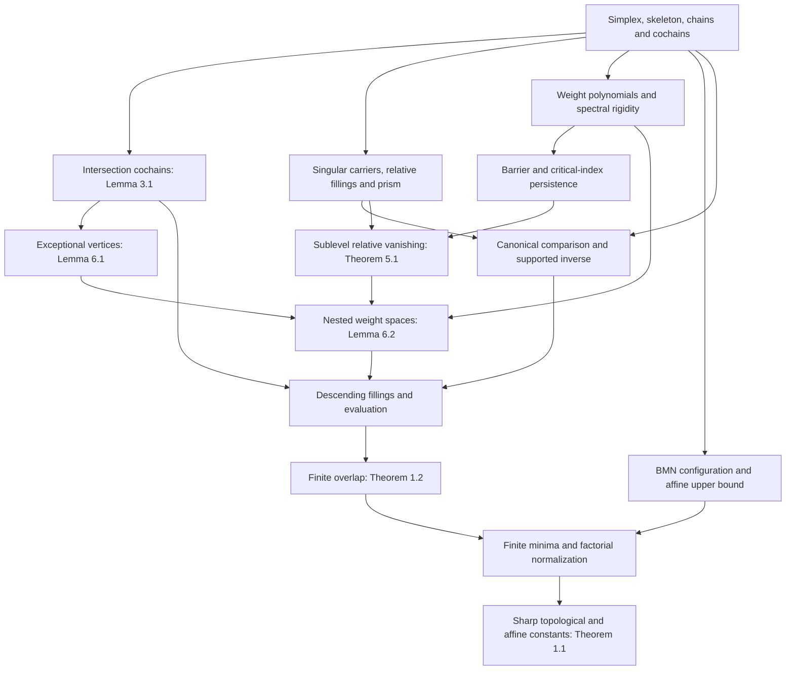

# Formalization blueprint

This guide describes the proof architecture of the completed formalization of
Theorems 1.2 and 1.1 of *Sharp topological overlap in every dimension*.
The reference is the [9 November 2026 manuscript](../paper/sharp_topological_overlap.pdf)
and its [TeX source](../paper/sharp_topological_overlap.tex).
The [paper-to-Lean map](../FORMALIZATION.md) lists the principal declarations;
the [README](../README.md) gives the public statements and build commands.

## Scope and conventions

Both target theorems cover every positive dimension. Intermediate results
may be split, generalized, or replaced by sufficient alternatives.

For fixed `d ≥ 1`, the finite theorem bounds the overlap of every continuous
map from the `d`-skeleton of the simplex on `n` vertices to `ℝ^d` when
`n > deletionBound d`. The asymptotic theorem identifies the limit of both
the topological and affine finite minima, normalized by `choose(n,d+1)`,
with `(d+1)!/(d+1)^(d+1)`.

| Mathematical object | Lean representation and convention |
| --- | --- |
| Source vertices | `Fin n`; helper results often use a general finite type. |
| Probability simplex | `Simplex V`, an abbreviation for `Convexity.StdSimplex ℝ V`; coordinates are `μ.weights`. |
| Closed and open faces | Support contained in, or equal to, the vertex set. An open zero-dimensional face contains its vertex. |
| Source skeleton | `Skeleton V d`, the subtype of simplex points supported on at most `d+1` vertices; a homeomorphism identifies it with the abstract skeleton's realization. |
| Overlap | `overlap f`, the attained maximum number of indexed source top faces whose closed images contain one point. Coincident images retain their source indices. |
| Chains and cochains | TauCeti ordered simplicial chains and functions on the same cells, with coefficients in `ZMod 2`. Source cochains are on the full simplex; vertex cocycle identities are checked in degree `d+1`. |
| Singular carriers | Chains in the image of inclusion from a subspace, with an equivalent simplex-support description. Relative homology and fillings use these actual chain modules, including degree zero. |
| Coordinates for analysis | Finite functions `V → ℝ` for polynomial calculations, transported to `EuclideanSpace ℝ V` for inner products, Hessians, and Morse theory. |
| Constants and division | `deletionBound d` uses natural-number division for `⌊d/p⌋`; overlap estimates and `overlapThreshold d` use real arithmetic. |
| Finite minima | Attained natural minima over all continuous maps, and independently over vertex placements with affine interpolation. Their real normalizations are total, including the zero-denominator initial terms. |

## Proof dependencies

The arrows show mathematical dependencies between the main branches, rather
than every individual Lean import. All branches are implemented and checked.

## The finite lower bound

### Geometry and intersection cochains

The geometric branch constructs the data of Lemma 3.1 from an arbitrary
continuous map. Compactness first supplies perturbation tolerances that
preserve common-intersection information for every relevant source-face
family. A common iterated barycentric model supplies both the piecewise
affine approximations and the subdivision chains used to pull back cochains.

Generic placements enforce affine independence, strong general position,
below-complementary avoidance, and spanning directions simultaneously.
Complementary intersections give local indicators; the endpoint parity of
one-dimensional intersections gives their facet-coboundary identity. A
subdivided enclosing target and its cycle give the normalization. Strong
general position bounds disjoint support families. These constructions
produce all five properties of `IntersectionData`, with no geometric
existence assumption left in the final theorem.

The main modules are `Geometry/Barycentric*.lean`,
`Geometry/GenericPlacements.lean`, `Geometry/SourceApproximation.lean`,
`Geometry/SimplexParity.lean`, `Geometry/Target*.lean`, and `Intersection/`.
The branch ends at `exists_intersectionData` in
[`Intersection/Existence.lean`](../SharpTopologicalOverlap/Intersection/Existence.lean).

### Singular chains and the supported comparison

The singular-chain interface turns relative homology vanishing into concrete
fillings with controlled carriers. The prism construction transports these
fillings through the deformations used later in the proof.

The comparison branch proves that the canonical affine simplicial-to-singular
chain map induces homology isomorphisms. It uses cellular basis classes and
naturality, retaining the actual affine generators. The supported inverse
and chain homotopy preserve every simplicial carrier simultaneously; the
inverse is normalized to send the uniform point chain to a chosen vertex.
Ambient precomplexes allow subcomplexes which omit vertices.

The main modules are `Singular/` and `Comparison/`. The public interfaces are
[`Singular/Relative.lean`](../SharpTopologicalOverlap/Singular/Relative.lean),
[`Singular/Deformation.lean`](../SharpTopologicalOverlap/Singular/Deformation.lean),
and [`Comparison/Supported.lean`](../SharpTopologicalOverlap/Comparison/Supported.lean).

### Polynomial sublevels and relative vanishing

Weight polynomials encode uniform cocycle families. Their derivatives,
Euler identities, and face restrictions lead to spectral rigidity: a
face-critical point with value in `(0, overlapThreshold d)` has negative index at least
`d+1`. The equality analysis identifies the complete multipartite case at
the threshold.

A logarithmic barrier moves the analysis to the open probability simplex.
Properness and a small generic linear tilt give compact Morse bands.
Critical-index persistence transfers the facewise spectral bound to the
perturbed barrier. A retracting neighborhood of the polynomial zero set,
an interior push, and Morse-band vanishing then yield relative homology
vanishing in every degree at most `d`, including degree zero.

The main modules are `Polynomial.lean`, `Spectral/`, `Barrier/`, and
`Sublevel/`. The branch ends at `sublevel_cycle_fills` and
`sublevel_homology_vanishes` in
[`Sublevel.lean`](../SharpTopologicalOverlap/Sublevel.lean).

### Deletion, weight spaces, and the contradiction

For each positive-dimensional target face, a maximal disjoint support family
is chosen once. The unions of its source vertices give compatible exceptional
sets, each of size at most `deletionBound d`. On the remaining vertices the
vertex cochains agree and define a uniform cocycle. Deleting exceptional
mass deforms each weight-space pair to the corresponding polynomial
sublevel pair, so the preceding vanishing theorem supplies its fillings.

If the claimed finite lower bound fails, the uniform source point lies in
every weight space. Starting with this point on the target top cycle, the
proof fills successively down through the target dimensions. The supported
comparison converts the resulting singular chains to simplicial chains.
Cochain evaluation is constant between successive dimensions, equals one
at the top by normalization, and equals zero at target vertices by the
cocycle identity.

The main modules are `Deletion.lean`, `WeightSpaces/`, and `Descending/`.
[`Finite/Assembly.lean`](../SharpTopologicalOverlap/Finite/Assembly.lean)
assembles the interfaces; [`Finite.lean`](../SharpTopologicalOverlap/Finite.lean)
discharges the comparison and sublevel inputs and proves
`finite_overlap_bound`.

## The sharp asymptotic constant

The upper-bound branch formalizes the Bukh–Matoušek–Nivasch construction
used in manuscript Theorem 7.1. Separated recursive configurations, augmented
determinants, and the type-counting argument give the uniform bound

$$
\left(\frac{n}{d+1}\right)^{d+1}+2d\binom{n-1}{d}
\le \left(\frac{n}{d+1}\right)^{d+1}+2dn^d.
$$

In dimensions `d ≥ 2`, the geometric theorem also gives convex position
and affine independence of every top face. Affine interpolation identifies
each closed source-face image with its convex hull. The modules `BMN/` and
[`BMN.lean`](../SharpTopologicalOverlap/BMN.lean) therefore give an upper
bound for the independently defined affine minimum and hence for the
continuous minimum.

[`Overlap/Minimum.lean`](../SharpTopologicalOverlap/Overlap/Minimum.lean)
defines and compares these minima. Dividing the finite lower bound and the
BMN upper bound by `choose(n,d+1)` gives two sequences with the same limit
`overlapThreshold d`. The squeeze arguments in
[`Asymptotic.lean`](../SharpTopologicalOverlap/Asymptotic.lean) prove convergence
of both normalized minimum sequences. Their liminfs give Theorem 1.1 and
the affine equality `sharp_overlap_constants`.

## Library boundary and verification

Mathlib supplies the probability simplex, finite-dimensional analysis,
linear algebra, convex geometry, and limit infrastructure. TauCeti supplies
ordered simplicial chains, realizations and subdivisions, singular and
relative homology, cellular comparison, and Morse-band machinery. Project
modules prove the specific geometric, spectral, support, and counting
statements and connect these library interfaces.

The public entry point is `import SharpTopologicalOverlap`. The complete
root build checks all project modules. The retained statement and axiom
audits are described in the [README](../README.md); proof dependencies of
the public endpoints contain only `propext`, `Classical.choice`, and
`Quot.sound`. The manuscript and historical audit output are not proof
inputs.
