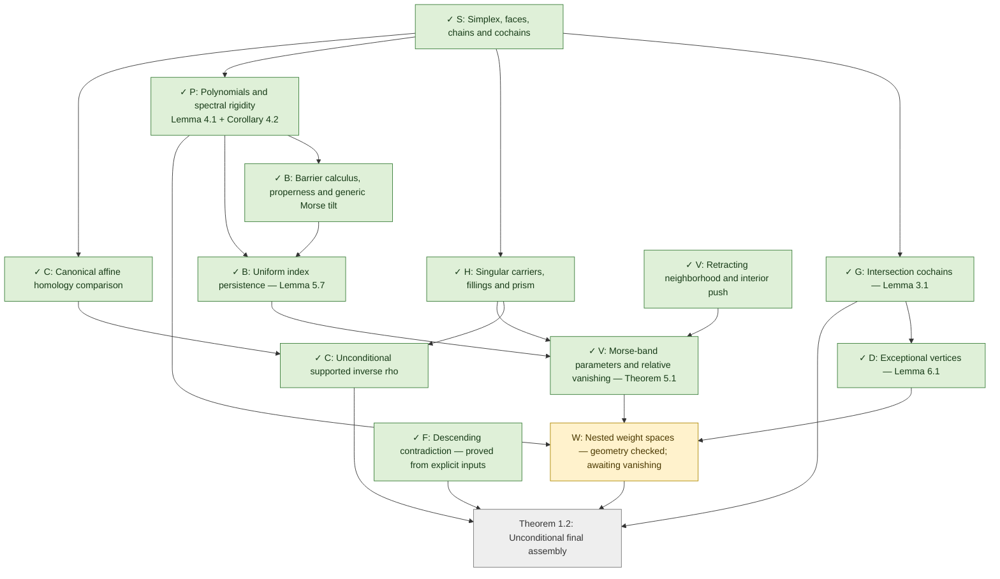

# Blueprint for Theorem 1.2

This blueprint follows the 9 November 2026 [manuscript](../paper/sharp_topological_overlap.pdf) and [TeX source](../paper/sharp_topological_overlap.tex). It covers the finite overlap theorem and every ingredient used to prove it. The [dependency assessment](dependency-assessment.md) records the inspected external libraries and the completed import checks. References to section symbols and numbered mathematical results below use the manuscript's numbering.

The foundation block in §3 implements probability simplices, faces, the realized skeleton, overlap, and finite chains and cochains. See [the formalization status](../FORMALIZATION.md) for the checked declarations and [the foundation plan](foundation-plan.md) for the work division. Block G is complete: `exists_intersectionData` proves Lemma 3.1, constructing a finite target of dimension exactly `d` and all five cochain properties from the continuous map. Its [implementation plan](intersection-plan.md) and [verification record](intersection-verification.md) describe the actual subdivision, placement, parity and cochain construction. The singular support, deletion, polynomial, spectral, and canonical comparison branches and the abstract descending contradiction are also complete. The analytic sublevel branch remains open. **Module and declaration names below are proposed unless recorded as implemented in the formalization status.**

## 1. Target and conventions

For $d\ge2$, let $X_{n,d}$ be the complex of nonempty subsets of $[n]$ with at most $d+1$ vertices. For a continuous map $f:|X_{n,d}|\to\mathbb R^d$, define
$$
 \operatorname{ov}(f)=
 \max_{y\in\mathbb R^d}
 \#\{\sigma\subseteq[n]:|\sigma|=d+1,\ y\in f(|\sigma|)\}.
$$
The faces $|\sigma|$ are closed. The overlap counts source faces, including when different faces have the same image.

The existing natural-number constant is
$$
 C_d=\sum_{p=1}^{d}\binom{d+1}{p+1}(d+1-p)\left\lfloor d/p\right\rfloor.
$$
The final proposed declaration `finite_overlap_bound` must assert
$$
 2\le d,\quad C_d<n
 \quad\Longrightarrow\quad
 (\operatorname{ov}(f):\mathbb R)\ge
 \left(\frac{(n:\mathbb R)-(C_d:\mathbb R)}{(d:\mathbb R)+1}\right)^{d+1}.
$$
Write $\theta=(d+1)!/(d+1)^{d+1}$, as a real number. Prove $d+1\le C_d$ for $d\ge2$, so $C_d<n$ supplies the size hypothesis for Lemma 3.1. Use natural division in $C_d$ and real division in the displayed bound.

Use the following conventions throughout the implementation.

| Object | Representation and required interface |
| --- | --- |
| Source vertices | `Fin n`. General helper lemmas may use a finite type `V`. Add a linear order where the ordered-chain construction requires it. |
| Probability simplex | `Convexity.StdSimplex ℝ V`. Read coordinates through `μ.weights i`. For finite `V`, identify these finitely supported coordinates with `V → ℝ`. |
| Closed and open faces | A closed face has support contained in its vertex set. An open face has support equal to that set. In particular the open 0-face contains its vertex. |
| Skeleton | The subtype of simplex points with `μ.weights.support.card ≤ d + 1`. Prove a homeomorphism to TauCeti's realization of the abstract skeleton. |
| Complexes and subcomplexes | Reuse `AbstractSimplicialComplex` for a complex on its actual vertices and `PreAbstractSimplicialComplex` for a subcomplex on an ambient vertex type. |
| Simplicial chains | `TauCeti.OrderedSimplicialChain K (ZMod 2) k`, a finitely supported function on the $k$-faces. Preserve the face indexing through all subdivisions. |
| Cochains | Functions from the same face type to `ZMod 2`, with evaluation extended linearly to chains. Source cochains live on the full simplex, including degree $d+1$. |
| Singular chains | The degree objects of `TauCeti.singularChains (ZMod 2)`. Reuse its chain complex and generator maps. |
| Analysis | An explicit coordinate equivalence between `V → ℝ` and `EuclideanSpace ℝ V`. The former has the sup norm, while the latter supplies the inner product for Hessians and projections. |
| Universes | `Type`, `TopCat.{0}`, and `ModuleCat.{0} (ZMod 2)` suffice for this target and match the universe parameters of `singularChains`. |

The new simplex type, its topology, the ordered-chain boundary API, the concrete singular-chain equivalence, and the realization/neighborhood API were checked in a temporary Lean probe on the installed pins. The interfaces between those objects are the work specified below. [Simplex][simplex] · [Ordered chains][chains] · [Concrete singular chains][singular-finsupp]

## 2. Proof dependencies and planned modules

The final proof has three substantial branches. Appendix A constructs the intersection cochains. The comparison branch gives a chain map that preserves every simplicial subcomplex. The spectral and barrier branch gives relative fillings in the weight spaces. Finite matching arguments and the descending construction combine them.

Green means checked in Lean, yellow means active assembly, and red marks the
main remaining technical bottleneck. Some checked subblocks are awaiting
the commit of their larger block. Theorem 1.2 remains open. This chart was
updated during the autonomous implementation on 9 November 2026.

Use modules with the following responsibilities. Split a module further when its proof grows, while retaining these interfaces.

| Proposed module under `SharpTopologicalOverlap/` | Main output | Direct project prerequisites |
| --- | --- | --- |
| `Simplex.lean` | Probability simplex, faces, finite/Euclidean coordinates, compactness, realization by support | `Basic` |
| `Skeleton.lean` | Realized skeleton and its weights/closed-face-preserving identification with TauCeti's realization | `Simplex` |
| `Overlap.lean`, `Overlap/Constant.lean` | Attained overlap, binomial and common-point bounds, constant-map and absent-face formulas | `Skeleton`, then `Overlap` |
| `Simplicial.lean` | Full-simplex cochains, evaluation, coboundary, support families and inclusions | TauCeti's ordered chains; independent of project geometry |
| `Simplicial/Subcomplex.lean` | Ambient chains/cochains, inclusion, restriction and evaluation for vertex-omitting subcomplexes | `Simplicial` |
| `Singular.lean` | Carried chains, relative-cycle filling criterion, support-controlled prism | `Simplex` |
| `Comparison.lean` | Canonical affine comparison and the supported maps $\rho,Q$ | `Simplicial`, `Singular` |
| `Geometry/Subdivision.lean`, `Geometry/Barycentric*.lean`, `Geometry/TargetCycle.lean` | Indexed affine chains and the actual iterated simplicial model, mesh, interpolation and subdivision chain map | `Simplex`, `Simplicial` |
| `Geometry/GenericPlacements.lean`, `Geometry/SourceApproximation.lean` | Four simultaneous generic-placement conditions and actual first/second source approximations | Barycentric geometry and the four placement modules |
| `Geometry/Intersections.lean`, `Geometry/SimplexParity.lean` | Complementary point counts and geometric facet parity | Generic placements, segments and affine-constraint parity |
| `Intersection.lean`, `Intersection/Existence.lean` | Five-property interface and the proved existence theorem of Lemma 3.1 | Actual target geometry, local indicators, chain pullback and normalization |
| `Polynomial.lean` | Weight sums, differential formulas, bounds and independence complexes | `Simplex`, `Simplicial` |
| `Spectral.lean` | Lemma 4.1 and Corollary 4.2 | `Polynomial` |
| `Barrier.lean` | Open-simplex coordinates, generic Morse tilt and Lemma 5.7 | `Spectral` |
| `Sublevel.lean` | Theorem 5.1 as homology vanishing and an actual filling operation | `Barrier`, `Singular` |
| `Deletion.lean` | Compatible exceptional sets and Lemma 6.1 | `Simplicial`, the interface of Lemma 3.1 |
| `WeightSpaces.lean` | Lemma 6.2 and the nested pairs $(B_\tau,J_\tau)$ | `Deletion`, `Polynomial`, `Sublevel` |
| `Descending.lean` | A finite algebraic contradiction from explicit cochain and filling data | `Simplicial`, `Singular`, the interface of $\rho$ |
| `Finite.lean` | `finite_overlap_bound` | `Comparison`, `Intersection`, `WeightSpaces`, `Descending` |

Make future project modules import their direct prerequisites and expose them through `SharpTopologicalOverlap.lean`. The abstract statements used in `Descending` can be established before the three branches are complete. State their inputs as hypotheses or fields of explicit data, then prove the theorem from those inputs. The final theorem must construct and discharge all of them.

Theorems 1.1 and 1.2 must retain their manuscript statements. Intermediate
results and module boundaries may be adapted when a different route simplifies
formalization. Reuse exact library results, and inspect the implementations of
similar results when adapting a proof.

## 3. Realized faces, overlap, and finite cochains

### Simplex and overlap

Implement the following in this order.

1. Define coordinate support, the uniform vector for a nonempty finite vertex type, and the coordinate point of a vertex. Prove nonnegativity, total mass one, compactness, and continuity of each coordinate.
2. Define closed faces by support inclusion and open faces by support equality. Prove the face-intersection rule, the finite union description of a realization, and compactness of every closed face.
3. Define the realized skeleton. Identify it with the realization of the full simplex's $d$-skeleton and identify each of its closed faces under the same map. This transports an arbitrary continuous map between the two presentations.
4. For a query point $y$, define the finite set of $(d+1)$-vertex faces whose closed images contain $y$. Its cardinality is at most $\binom n{d+1}$. The set of attained cardinalities is nonempty and finite, so its maximum defines `overlap`.
5. Prove attainment, the pointwise upper bound by `overlap`, and the consequence that any family of source $d$-faces with a common image point has size at most `overlap`. This last consequence is the API consumed by §6.

**Completion check.** Type-check the target proposition in a temporary probe using the actual continuous-map domain, real casts, and existing `deletionBound`. Check that the same closed-face images appear in the overlap and in the geometric construction. Introduce the theorem declaration when its proof is ready.

The open-face convention needs a local definition. Mathlib's `Affine.Simplex.interior` uses weights in $(0,1)$ and has empty interior for a 0-simplex. The paper uses positive barycentric coordinates, including its single vertex in dimension zero. [Simplex interior convention][interior]

### Simplicial algebra

For each degree $k$, identify a cell of the full simplex with a finite set of cardinality $k+1$. Prove the boundary formula over `ZMod 2`, where all alternating signs equal one. Reuse TauCeti's boundary-square-zero theorem.

Define evaluation $\langle a,c\rangle$ and coboundary by dualizing the boundary. Establish
$$
 \langle\delta a,c\rangle=\langle a,\partial c\rangle,\qquad
 \delta^2=0.
$$
A degree-zero chain has zero boundary. Give boundary and coboundary lemmas with successor degrees so the base case does not depend on truncated natural subtraction.

Represent a finite family of faces by `Finset (Finset V)` with a uniformity predicate. Provide conversions between the support of a $k$-cochain and a $(k+1)$-uniform family. The cocycle predicate must mean that every $(k+2)$-set contains an even number of supported $(k+1)$-sets.

Provide inclusion and restriction maps, evaluation on chains carried by a subcomplex, and the rule that a cochain vanishing on all relevant faces of a subcomplex evaluates to zero there. Choose all coefficients and boundary conventions once. [Ordered boundary][chains]

## 4. Singular support and the comparison map

### Carried chains and relative fillings

Use one ambient chain module for each space. Define `CarriedBy A c` by membership in the image of the chain map induced by the subspace inclusion $A\hookrightarrow X$. Prove that this is equivalent to every nonzero singular simplex of $c$ having image in $A$.

The concrete support is available through `SSet.chainsLinearEquivFinsupp`. Its map formula is `Finsupp.mapDomain`, and `TopCat.mem_range_toSSet_subtypeVal_iff` identifies the simplices arising from a subspace. Prove the following local rules before using the predicate in a long proof.

- Zero, addition and scalar multiplication preserve the carrier. Carrier inclusion is monotone.
- Boundary preserves the carrier, and a continuous pushforward sends it into the image carrier.
- The union of the images of the nonzero singular simplices is compact.
- The image of a sum is contained in the union of the two chain images. Allow cancellation of simplices.
- A chain carried by a subspace can be lifted to a chain in that subspace, and the inclusion is injective on chains.

Define a relative cycle in degree zero separately, where every chain qualifies. In successor degree, require the boundary to be carried by the smaller subspace.

The proposed `relative_cycle_fills` contract is
$$
 J\subseteq B,\quad H_j(B,J)=0,\quad
 c\in S_j(B),\quad \partial c\in S_{j-1}(J)
 \ \Longrightarrow\
 c=\partial w+c',\quad w\in S_{j+1}(B),\ c'\in S_j(J).
$$
Prove it on the actual TauCeti chain modules by passing to the relative cokernel, filling the resulting cycle, lifting the filling, and lifting the remaining kernel element from $J$. Establish the degree-zero case as part of the same interface. [Concrete singular chains][singular-finsupp] · [Subspaces][subspace] · [Relative chains][relative]

### Prism with a carrier bound

For $H:Y\times[0,1]\to Y'$ starting at inclusion, construct the degree-raising operator and prove
$$
 \partial P(c)+P(\partial c)=c+(H_1)_\#c,\qquad
 \operatorname{im}P(c)\subseteq H(\operatorname{im}c\times[0,1]).
$$
Use the existing chain homotopy and its naturality after restricting $H$ to the image of $c$ and corestricting to its image. In particular, when $H$ fixes $J$, $P$ carries chains from $J$ into $J$.

Derive Lemma 2.2(b) for strong deformation retracts and 2.2(c) for a finite chain of nested pairs. These consequences support the proof of Theorem 5.1 and the deletion homotopy. [Prism naturality][prism] · [Pair homotopies][pairs]

### Canonical affine comparison, Theorem 2.3

Define `affineChainMap` by sending an ordered face $\{v_0<\cdots<v_k\}$ to the affine singular simplex with those vertex images. Prove compatibility with each face map and hence with boundary. Prove compatibility with subcomplex inclusion.

The required theorem is that **this map** induces an isomorphism on homology for every finite ordered complex and every degree. TauCeti's `orderedSimplicialHomologyIsoSingularHomology` passes through cellular chains. Identify the affine face generator with the relative generator of its cell, then use the exact sequences for skeleta to obtain the canonical-map statement. TauCeti provides the characteristic-pair homology isomorphism. The identity-simplex generator argument in hatcher-at is a possible source for a port if the needed identification is missing. Its package targets an older toolchain. [Ordered comparison][comparison] · [Characteristic pairs][characteristic] · [Identity generator][generator]

A subcomplex $L$ can omit ambient vertices. Apply the ordered-complex theorem after reindexing $L$ on the subtype of its actual vertices. Transport its chains and realization back to the fixed ambient simplex.

Extract two concrete corollaries.

1. If a simplicial cycle carried by $L$ has affine image bounding in $|L|$, it has a simplicial filling carried by $L$.
2. Every singular cycle carried by $|L|$ is homologous there to the affine image of a simplicial cycle carried by $L$.

**Completion check.** Both statements must concern the defined `affineChainMap` and the given carrier $L$.

### Supported inverse, Lemma 2.4

For a singular simplex $s$ in $\Delta(V)$ define
$$
 L_s=\{\tau\ne\varnothing:
       \tau\subseteq\operatorname{supp}\mu
       \text{ for some }\mu\in\operatorname{im}s\}.
$$
It is downward closed, contains $\operatorname{im}s$ in its realization, and decreases on the singular faces of $s$. Its homology can be nontrivial.

Construct $\rho$ and an auxiliary singular operator $Q$ by degree induction, maintaining
$$
 \rho(s)\in C_*(L_s),\quad Q(s)\in S_*(|L_s|),\quad
 \partial Q(s)+Q(\partial s)=\iota\rho(s)+s,\quad
 \partial\rho(s)=\rho(\partial s).
$$
In degree zero choose a vertex in each point's support, prescribing $x$ at the uniform point $u$. Use the affine edge from the point to the chosen vertex for $Q$.

In degree $k\ge1$, use the injectivity corollary to fill $\rho(\partial s)$ simplicially. The resulting singular cycle is then handled by the surjectivity corollary. Extend the choices linearly with `TauCeti.chainsDesc`.

The output `supportedComparison` must give one map $\rho$ that preserves **every** subcomplex simultaneously, commutes with boundary, and satisfies $\rho([u])=x$. Define it in all degrees. Section 6 uses $\rho(c_v)$ in degree $d+1$ at target vertices. [Paper Lemma 2.4](../paper/sharp_topological_overlap.tex#L171)

## 5. Intersection cochains from Appendix A

**Completed.** `exists_intersectionData` in `Intersection/Existence.lean`
proves Lemma 3.1 from $2\le d$, $n\ge d+1$ and an arbitrary continuous map.
`IntersectionWitness` bundles the constructed finite target, its
`IntersectionData`, and an actual top cell, proving dimension exactly $d$.
All subdivisions, approximations, placements, cycles and local intersection
counts are constructed in its checked dependencies. See [the current mapping](../FORMALIZATION.md)
and [independent verification](intersection-verification.md).

`IntersectionData` records a finite target complex $T$ with faces of dimension at most $d$, a $d$-cycle $\zeta$, and $a_\tau\in C^{d-\dim\tau}(\Delta([n]))$. Its proved fields are exactly the following statements.

1. For every positive-dimensional $\tau$,
   $\delta a_\tau=\sum_{\eta\text{ facet of }\tau}a_\eta$.
2. For every target vertex $v$, $\delta a_v=0$ on $(d+1)$-faces of the full source simplex.
3. $\sum_{\tau\in T_d}\zeta(\tau)a_\tau=\mathbf1$.
4. For each $\tau$, the original images of all source $d$-faces containing any support face of any $a_\eta$, $\eta\le\tau$, have one common point.
5. For each $\tau$ of dimension $p>0$, a pairwise vertex-disjoint family in $\operatorname{supp}a_\tau$ has size at most $d/p$.

These fields suffice for §6. The witness includes a top cell; alternatively, normalization forces one whenever the source has a vertex.

### Subdivision and fundamental chains

The completed route uses `barycentricModel K j`, with a realization homeomorphism, physical vertex positions and original-face carriers. Its actual abstract cells are used by both interpolation and chains. Coverage follows from the homeomorphism; original-face support and the shrinking mesh are proved in `BarycentricGeometry` and `BarycentricApproximation`.

`iteratedSubdivision K j k` is constructed directly on those actual cells by recursively coning the subdivided boundary to the full-face vertex. Its boundary identity and carrier property are proved. Unique parent-facet and flag-cardinality lemmas establish coefficient one on every top child. The earlier affine-chain and one-step bridge developments remain auxiliary; the existence proof does not require a converse identification with their permutation indexing.

The metric donor in DifferentialGeometry gives the bound
$$
 \operatorname{mesh}(K^{(j)})
 \le\left(\frac m{m+1}\right)^j\operatorname{mesh}(K)
$$
from a bound of $m+1$ vertices per simplex, even when the ambient Euclidean dimension is larger. The corresponding estimate is proved on the actual model, together with uniform interpolation approximation and small physical hull images for continuous maps. [Subdivision homeomorphism][subdivision] · [Geometric subdivision donor][mesh] · [Affine-chain mesh][chainmesh]

### Generic placements and approximation

The four conditions of Lemma A.2 are proved separately and combined in `exists_genericPlacement`.

| Condition | Proved statement | Proof method |
| --- | --- | --- |
| G1 | Disjoint source vertex sets have no common hull intersection when the sum of their dimensions is less than $d(s-1)$ for $s$ sets | Openness from compact barycentric coefficients, density by independent translations outside a proper affine image |
| G2 | Each source simplex has affine-independent vertex images | Successive avoidance of proper affine spans |
| G3 | A source hull misses a fixed target simplex below complementary dimension | Compactness for openness and translations outside a proper affine subspace for density |
| G4 | Source and target direction spaces span $\mathbb R^d$ at or above complementary dimension | Successive rank growth modulo fixed target directions, with openness from a nearby basis |

There are finitely many tuples in these conditions. Their open dense loci have open dense intersection, giving a placement arbitrarily close to a prescribed one. DifferentialGeometry's finite-placement theorem supplies the affine-independence part. [Placement donor][placements]

The compact separation lemmas choose a single positive tolerance for all families of original closed faces, including empty families. The first tolerance transfers common-image properties from $g$ to $f$. The second, chosen after $g$, transfers a family whose $h$-images meet a small target carrier to a common point for $g$.

The proved continuity, hull-image identity and interpolation error bounds give `exists_first_source_approximation` and `exists_second_source_approximation`. The existence proof follows the paper's parameter order
$$
 f\longrightarrow g\text{ satisfying G1}
 \longrightarrow\varepsilon(g),D,T_D
 \longrightarrow h\text{ satisfying G2,G3,G4}.
$$
The G1 argument is applied to $g$. The estimates for $h$ transfer a family meeting one small target simplex to a common point for $g$, then to a common point for $f$.

### Intersection parity and the five properties

Under G2–G4, `Intersections` proves uniqueness of complementary intersections and exclusion of proper faces. `localIndicator` is the `ZMod 2` indicator of nonempty hull intersection.

For dimensions summing to $d+1$, `SimplexParity` proves geometric facet parity. Barycentric coordinates on the common affine line turn the hull intersection into a compact feasible parameter set. Lower-face avoidance gives a unique active constraint and spanning directions give nonzero active slopes. The endpoint theorem then proves that the total facet-intersection count is zero modulo two, including the empty case. No scalar or geometric parity hypothesis remains in the final existence theorem.

Keep source simplices as indices in these sums. The map $h$ is injective on each source child simplex, while images of different child simplices may overlap.

The actual target is a barycentric subdivision of the boundary of a standard $(d+1)$-simplex. One distinguished facet is physically realized as an enclosing simplex $D$; the remaining facets contain an infinity vertex. `refinedCycle` is closed and has coefficient one on every top cell. `targetCells` uses the hull of patch vertices in each cell, so carriers stay monotone on outer cells as well as inner ones. Outer carriers lie in proper faces of $D$ and miss $h(|X|)$; the infinity carrier is empty. The chosen tolerance already incorporates the separation factor of three, so the proof encloses the closed $\varepsilon_g$-neighborhood and takes mesh and perturbation below $\varepsilon_g$. Pulling local indicators back through the actual source subdivision chain map defines the full source cochains.

The five fields are proved as follows.

- Sum geometric facet parity and commute the actual subdivision map with boundary to obtain the facet coboundary identity; outer-cell identities follow from vanishing and monotonicity.
- `TargetCoverage` and generic avoidance give unique top-cell incidence at each original source vertex. Coefficient one in the actual cycle gives normalization.
- Every target vertex has an edge path to the zero infinity cochain. The facet identity and $\delta^2=0$ give the cocycle equation in degree $d+1$ on the full source simplex.
- `SupportMeets`, target-carrier monotonicity and the two compact separation estimates give one common point for all upward support faces simultaneously.
- If $s$ disjoint support faces occur at a target $p$-face, the transfer to $g$ and G1 give $s(d-p)\ge d(s-1)$, hence $sp\le d$. Handle $s=1$ using $p\le d$, and conclude $s\le d/p$ with $p>0$.

**Completed endpoint.** `exists_intersectionData` has exactly $2\le d$, $n\ge d+1$ and the continuous map as inputs. Its transitive axiom audit contains only `propext`, `Classical.choice` and `Quot.sound`; no placeholders or project axioms supply any construction. [Lemma 3.1 and Appendix A](../paper/sharp_topological_overlap.tex#L216)

## 6. Weight polynomials and spectral rigidity

### Finite sums and derivatives

For a family $G$ of $(d+1)$-sets, define on the ambient coordinate space
$$
 p_G(\mu)=(d+1)!\sum_{e\in G}\prod_{i\in e}\mu_i.
$$
Use this finite-sum definition for the analytic function. Differentiate finite products directly. Prove Euler's identities by rearranging those sums. The symbolic `MvPolynomial` representation is optional if a later lemma benefits from it, and would need an evaluation-to-Fréchet-derivative adapter.

The `Polynomial` interface needs the following results.

- Smoothness, homogeneity of degree $d+1$, explicit first and second derivatives, and zero diagonal of the Hessian.
- Nonnegativity, monotonicity in nonnegative coordinates, and monotonicity in the family.
- $p_G\le1$ and $0\le\partial_i p_G\le d+1$ on the simplex. Prove the common finite counting estimate
  \[
   k!\sum_{e\in\mathcal F}\prod_{i\in e}\mu_i
       \le\left(\sum_i\mu_i\right)^k
  \]
  for a $k$-uniform family and nonnegative coordinates, by counting ordered distinct tuples.
- The uniform value $(d+1)!\,|G|/|V|^{d+1}$ for nonempty $V$.
- $p_G(\mu)=0$ exactly when the support of $\mu$ contains no member of $G$.
- Restriction to a vertex subset for the function, its first derivatives on active coordinates, and its tangent Hessian.

Define the independence precomplex from the last support criterion. Its realization is the polynomial zero set.

### Lemma 4.1

Split the spectral argument into reusable matrix and finite-family statements.

1. At a full-support face-critical point of a nonempty cocycle, prove all partial derivatives agree. Euler's identities give
   \[
   \partial_i p_G=(d+1)t,\qquad
   \widetilde H v=d(d+1)t\,v,\qquad
   \|v\|=1,
   \]
   where $t=p_G(\mu)>0$, $\widetilde H_{ij}=\sqrt{\mu_i\mu_j}H_{ij}$ and $v_i=\sqrt{\mu_i}$.
2. Prove that coordinate rescaling identifies the face-tangent Hessian with $\widetilde H$ on $v^\perp$. Relate its negative index to `QuadraticForm.sigNeg`. Use the zero diagonal to obtain trace $-d(d+1)t$ on $v^\perp$.
3. Construct the covariance by a finite weighted sum of centered outer products with edge weights $(d+1)!\prod_{i\in e}\mu_i/t$. Prove
   \[
   \operatorname{Cov}
   =\widetilde H/t+(d+1)I-(d+1)^2vv^{\mathsf T}
   \succeq0.
   \]
   This bounds every eigenvalue on $v^\perp$ below by $-(d+1)t$.
4. Prove the elementary eigenvalue-count lemma. Trace $-d\kappa$, lower bound $-\kappa$, and $\kappa>0$ force at least $d$ negative eigenvalues. Exactly $d$ forces those eigenvalues to be $-\kappa$ and every remaining eigenvalue to be zero.
5. For the equality case assume the negative index is exactly $d$. Obtain the vectors $w_i$ from an orthonormal basis of the negative eigenspace. Prove the pair-Hessian identity and $\sum_{i\in e}w_i=0$ for every member $e$. Every edge weight is positive, so the finite weighted sum of squares gives a separate equality for every edge.
6. Prove the cocycle exchange argument. Label classes by the representatives in one fixed edge. Every vertex has exactly one such representative with the same $w$-vector. Every edge meets each class once, and parity permits exchanging vertices within a class, so every transversal is an edge.
7. Use the stationary derivative identity to show every class has mass $1/(d+1)$. Thus an index of exactly $d$ forces $p_G(\mu)=\theta$.

The proposed `spectral_index_rigidity` has the full hypotheses of Lemma 4.1. Then `faceCritical_index_ge` restricts to $\operatorname{supp}\mu$ and proves Corollary 4.2 for every face-critical point with $0<p_G(\mu)<\theta$.

**Completion check.** The equality case must be complete before using the strict-sublevel index bound. Include the case of a complete $(d+1)$-partite cocycle at equal class masses, where the value equals $\theta$. [Spectral theorem][spectrum] · [Negative index][signature] · [Paper §4](../paper/sharp_topological_overlap.tex#L228)

## 7. Logarithmic barrier and sublevel fillings

### Open-simplex coordinates and the Morse adapter

For the barrier development fix a finite vertex type $V$ with $N=|V|\ge2$. Let $E_0$ be the zero-sum subspace of `EuclideanSpace ℝ V`. Translate by the uniform vector $u$ and use
$$
 U=\{z\in E_0:u_i+z_i>0\text{ for every }i\}.
$$
This is an open subset of the finite-dimensional normed space $E_0$. Prove its identification with $\Delta^\circ(V)$, its boundaryless manifold instances, and the correspondence of differentials and Hessians under this affine chart.

The adapter must identify TauCeti's critical-point predicate with the vanishing of the differential on $E_0$, and `manifoldMorseIndex` with the negative index of the restricted Hessian. Check the Hessian convention explicitly. Coordinate inequalities on the tilt can express the paper's sup-norm bounds.

The imported Morse band theorem then gives relative vanishing in degree $j\le d$ from smoothness, Morse nondegeneracy, compactness of the closed band, regular endpoints, and an index bound $d+1$ at every critical point in the band. This imports the role of Theorems 5.3–5.4 and Lemma 5.5. [Morse band][band]

### Lemmas 5.2, 5.6 and 5.7

For $\varepsilon>0$ and a zero-sum tilt $\alpha$, define
$$
 \Phi_{\varepsilon,\alpha}(\mu)
 =p_G(\mu)-\varepsilon\sum_i\log\mu_i+\sum_i\alpha_i\mu_i
 \quad\text{on }\Delta^\circ(V).
$$
Prove the following in separate lemmas.

1. Smoothness and the displayed differential and Hessian formulas from Lemma 5.6(a).
2. Compactness of every sublevel, using
   $\mu_i\ge\exp(-(c+\|\alpha\|_\infty)/\varepsilon)$ on $\{\Phi\le c\}$. Deduce properness.
3. At critical points with $N\varepsilon\le1$ and $\|\alpha\|_\infty\le1$, use the multiplier equation, Euler's identity and the derivative bound to prove
   \[
   \mu_i\ge\varepsilon/(d+4),\qquad
   0\le-\varepsilon\sum_i\log\mu_i
      \le N\varepsilon\log((d+4)/\varepsilon).
   \]
4. For every fixed $\varepsilon>0$ and arbitrarily small tilt bound, choose a Morse tilt. Apply equal-dimensional Sard to the projected gradient $U\to E_0$, identify its derivative with the tangent Hessian, and use density of the complement of its critical values. Mathlib's Jacobian null-image theorem supplies Lemma 5.2. [Sard input][sard]
5. For $0<h_0<h_1<\theta$, find $0<\delta\le\min(1,1/N)$ such that every critical point with $0<\varepsilon<\delta$, $\|\alpha\|_\infty<\delta$ and value in $[h_0,h_1]$ has index at least $d+1$.

For the fifth step, follow the compactness argument of Lemma 5.7. The coordinate bound makes the barrier value tend to zero along critical points. At a limit $\mu$, first prove face-criticality on its support $\sigma$. Corollary 4.2 applies there.

Restrict the varying bilinear forms to the fixed tangent space $E_{\sigma,0}$ and use
$$
 \operatorname{Hess}p_G(\nu)|_{E_{\sigma,0}}
 +\varepsilon\sum_{i\in\sigma}\frac{x_i y_i}{\nu_i^2}.
$$
This family is continuous near $(0,\mu)$ because $\mu_i>0$ on $\sigma$. The linear tilt contributes zero Hessian. TauCeti's lower semicontinuity of `sigNeg` for bilinear families can package the persistence estimate. Carry its negative subspace into the full tangent space. The full barrier Hessians can fail to converge at coordinates disappearing from the support. [Signature continuity][sig-continuity]

### Theorem 5.1

Handle $G=\varnothing$ first, when both spaces equal the simplex. Otherwise $N\ge d+1$, so the open-simplex machinery applies. Put $Z=\{p_G=0\}$ and $B=\{p_G<\theta\}$.

1. Use the independence-complex identification and TauCeti's iterated-neighborhood theorem to choose an open $U$ with $Z\subseteq U\subseteq B$ that strongly deformation retracts onto $Z$. This construction can use the abstract realization branch independently of Appendix A's metric subdivision.
2. For a nonzero relative $j$-cycle $c$, use its compact image to choose the positive margin $\kappa=(\theta-\max_{\operatorname{im}c}p_G)/4$. Handle $c=0$ before taking this maximum.
3. Choose $0<\gamma<\kappa/3$ with $\{p_G\le4\gamma\}\subseteq U$. Choose a push time $t_0>0$ for $\psi_t(\mu)=(1-t)\mu+tu$ using uniform continuity on the full simplex.
4. Apply index persistence to $[2\gamma,\theta-\kappa]$. Choose $\varepsilon$, then a Morse tilt $\alpha$, so the barrier and tilt are uniformly small on $\psi_{t_0}(\Delta(V))$.
5. Choose regular endpoints in $(2\gamma,3\gamma)$ and $(\theta-2\kappa,\theta-\kappa)$. Apply the Morse band theorem, then `relative_cycle_fills`, to the pushed chain.
6. Use the prism to return the filling to $B$, leaving an error carried by $U$. Fill that error modulo $Z$ using the retract of $U$.

Export both `sublevel_relative_vanishing` and its chain-level consequence `sublevel_cycle_fills` for all $0\le j\le d$. The latter is the interface consumed by §6. [Neighborhood theorem][neighborhood] · [Paper Theorem 5.1](../paper/sharp_topological_overlap.tex#L293)

## 8. Exceptional vertices and nested weight spaces

From `IntersectionData`, let $P_\tau$ be the family of source $d$-faces containing a support face of some $a_\eta$ with $\eta\le\tau$. First prove
$$
 |P_\tau|\le\operatorname{ov}(f),\qquad
 \sigma\le\tau\Longrightarrow P_\sigma\subseteq P_\tau.
$$

### Lemma 6.1

Choose one maximal disjoint family $M_\eta$ for **each** positive-dimensional target face $\eta$. Define $S_\tau$ by taking the union of its members over all positive-dimensional subfaces $\eta\le\tau$. This global choice gives $S_\sigma\subseteq S_\tau$ whenever $\sigma\le\tau$. Let $Y_\tau=[n]\setminus S_\tau$.

For $p=\dim\eta$ with $1\le p\le d$, prove the matching-hits-support lemma and the bounds
$$
 |M_\eta|\le\lfloor d/p\rfloor,\qquad
 \left|\bigcup M_\eta\right|
 \le(d+1-p)\lfloor d/p\rfloor,\qquad
 |S_\tau|\le C_d.
$$
The last step counts $p$-subfaces by $\binom{d+1}{p+1}$. Then $C_d<n$ gives $Y_\tau\ne\varnothing$.

Every positive-dimensional $a_\eta$, $\eta\le\tau$, vanishes on $Y_\tau$. Use the edge coboundary identity to prove that all vertex cochains of $\tau$ agree there. Their common support gives a $(d+1)$-uniform cocycle $G_\tau$ on $Y_\tau$, by the full-simplex identity $\delta a_v=0$. Prove
$$
 \{\sigma\in P_\tau:\sigma\subseteq Y_\tau\}=G_\tau.
$$
At a target vertex $v$, $S_v=\varnothing$. [Paper Lemma 6.1](../paper/sharp_topological_overlap.tex#L458)

### Lemma 6.2

Define the subsets of the same ambient simplex
$$
 B_\tau=
 \left\{\mu:p_{P_\tau}(\mu)<
 \theta\left(1-\sum_{i\in S_\tau}\mu_i\right)^{d+1}\right\},
 \qquad J_\tau=|I_{G_\tau}|.
$$
The inclusion of $J_\tau$ into the ambient simplex factors through the face on $Y_\tau$.

Prove $J_\tau\subseteq B_\tau$, and for $\sigma\le\tau$ prove $B_\tau\subseteq B_\sigma$ and $J_\tau\subseteq J_\sigma$. Under the strict contrary bound
$$
 \operatorname{ov}(f)<((n-C_d)/(d+1))^{d+1},
$$
use the uniform polynomial value and $|S_\tau|\le C_d$ to show $u\in B_\tau$.

For relative vanishing, prove the displayed exceptional-mass deletion homotopy in the paper. Its denominator is positive because membership in $B_\tau$ forces the $S_\tau$-mass $t<1$. Prove it stays inside $B_\tau$ using homogeneity and coordinate monotonicity after division by $(1-t)^{d+1}$. Its endpoint lies in the face on $Y_\tau$, and it fixes $B_\tau\cap\Delta(Y_\tau)$ pointwise, including $J_\tau$.

On that face $p_{P_\tau}=p_{G_\tau}$. Apply `sublevel_cycle_fills` over the actual finite type $Y_\tau$, then transport the filling through the face inclusion and the prism. Export a filling operation on the ambient chains for every degree $0,\ldots,d$.

**Completion check.** All inclusions and sums in this operation use the common ambient simplex. Reindexing to $Y_\tau$ occurs inside the proof. [Paper Lemma 6.2](../paper/sharp_topological_overlap.tex#L488)

## 9. Descending fillings and the finite theorem

Prove a general `descending_evaluation_contradiction` from a finite $T$, a cycle $\zeta$, and cochains $a_\tau$ satisfying the facet identity, the vertex cocycle identity and the normalization in `IntersectionData`. Its other inputs are nested pairs, a common point $u$, relative fillings through degree $d$, and a chain map $\rho$ with $\rho([u])=x$. Require $a_\tau$ to annihilate $\rho$ of every chain carried by $J_\tau$.

Index the construction by the increasing filling degree $q=0,\ldots,d$, attached to target faces of dimension $p=d-q$. Initialize
$$
 z_\tau=\zeta(\tau)[u]\quad(p=d),
 \qquad
 z_\sigma=\sum_{\tau\supset\sigma,\ \dim\tau=p+1}c_\tau\quad(p<d).
$$
Choose $c_\tau$ with
$$
 z_\tau-\partial c_\tau\text{ carried by }J_\tau.
$$

For the top degree the boundary of $z_\tau$ is zero. At the next degree the cycle equation for $\zeta$ cancels the sum of top $z_\tau$. At every lower degree, each codimension-two coface has exactly two intermediate faces and cancels over $\mathbb F_2$. The remaining boundary errors are carried by $J_\sigma$ by nesting. Relative filling is therefore applicable.

Package the arithmetic transports between $d-p$, $d-(p-1)$ and successor degrees into named local lemmas. Work with coefficients of $\zeta$ throughout the construction.

Define
$$
 E_p=\sum_{\tau\in T_p}a_\tau(\rho(z_\tau)).
$$
The carrier condition and annihilation give
$$
 a_\tau(\rho(z_\tau))
   =(\delta a_\tau)(\rho(c_\tau)).
$$
The facet identity and reordering finite sums yield $E_p=E_{p-1}$ for $p>0$. The vertex cocycle gives $E_0=0$. The normalization and $\rho([u])=x$ give $E_d=1$.

In `Finite.lean`, assume the strict contrary overlap bound, obtain `IntersectionData`, construct all sets and fillers, instantiate $\rho$, verify annihilation on each $J_\tau$, and apply this contradiction. For $p>0$, the cochain vanishes on $Y_\tau$. At $p=0$, it is the indicator of $G_\tau$, while a $d$-face in $I_{G_\tau}$ is not a member of $G_\tau$. These give the two annihilation cases. All provider hypotheses are then discharged, yielding `finite_overlap_bound`.

**Completion check.** The final declaration must depend only on $2\le d$, $C_d<n$, and the continuous map. Inspect its axioms and the hypotheses of every intermediate provider. The imported Morse theorem supplies a verified component, while the complete barrier application, comparison and intersection construction must all be present in its checked dependencies.

## 10. Paper-to-Lean mapping

The table lists the endpoint to record when each item is implemented. The imported band result already has a checked specialization over $\mathbb F_2$. Its chart and Hessian identifications with the paper remain project work.

| Paper item and stable label | Proposed endpoint | Module or imported supplier |
| --- | --- | --- |
| $C_d$, `eq:C` | `deletionBound`, already defined | Existing `Basic` |
| Lemma 2.1, `lem:sd` | `subdivision_preserves_faces`, `subdivision_mesh_bound` | `Geometry/Subdivision` |
| Lemma 2.2, `lem:prism` | `prism_supported`, retract and filtration consequences | `Singular` |
| Theorem 2.3, `thm:hatcher` | `affineChainMap_homology_isIso` | `Comparison` |
| Lemma 2.4, `lem:comparison` | `supportedComparison` | `Comparison` |
| Lemma 3.1, `lem:intersection` | `exists_intersectionData` (proved) | `Intersection/Existence` |
| Lemma 4.1, `lem:spectral` | `spectral_index_rigidity` | `Spectral` |
| Corollary 4.2, `cor:index` | `faceCritical_index_ge` | `Spectral` |
| Theorem 5.1, `thm:weights` | `sublevel_relative_vanishing`, `sublevel_cycle_fills` | `Sublevel` |
| Lemma 5.2, `lem:sard` | `dense_regular_values_equidim` | `Barrier`, using mathlib's Jacobian theorem |
| Theorem 5.3, `thm:milnor` | Regular-band input to the imported Morse band theorem | TauCeti `Morse.Deformation.Homology` |
| Theorem 5.4, `thm:goresky` | Constant-coefficient critical-level input to the imported Morse band theorem | TauCeti `Morse.Cell.Homology` |
| Lemma 5.5, `lem:band` | `morse_band_vanishing`, after the open-simplex adapter | `Barrier`, using TauCeti `Morse.Cell.Band` |
| Lemma 5.6, `lem:barrier` | `barrier_smooth_proper`, `barrier_critical_bounds`, `exists_morse_tilt` | `Barrier` |
| Lemma 5.7, `lem:persistence` | `barrier_index_persists` | `Barrier` |
| Lemma 6.1, `lem:covers` | `exceptional_vertices` and its five conclusions | `Deletion` |
| Lemma 6.2, `lem:carriers` | `weightSpace_inclusions`, `uniform_mem_weightSpace`, `weightSpace_cycle_fills` | `WeightSpaces` |
| Lemma A.1, `lem:fundamental` | `boundary_fundamentalChain`, `boundary_iteratedSubdivision` (proved) | `Geometry/Subdivision`, `Geometry/TargetCycle` |
| Lemma A.2, `lem:generic` | `exists_genericPlacement`, `open_dense_genericPlacement` (proved) | `Geometry/GenericPlacements` |
| Theorem 1.2, `thm:finite` | `finite_overlap_bound` | `Finite` |

## 11. Execution order and completion criteria

Start with the following deliverables, each ending in checked Lean declarations.

| Order | Deliverable | Acceptance criterion |
| --- | --- | --- |
| 1 | Target definitions and finite cochain algebra | Theorem 1.2 has a precise statement using the intended domain and overlap. Evaluation/coboundary identities and carrier annihilation compile. |
| 2 | Singular carrier and filling API | Extract an actual relative filling in degree zero and successor degrees. Establish the prism's carrier bound. |
| 3 | Abstract descending contradiction | Prove the final algebraic argument from explicit data. This checks the degrees, nesting direction and normalization interfaces early. |
| 4 | Canonical affine comparison and $\rho$ | Prove the two carrier-wise comparison corollaries, then a single $\rho$ preserving every subcomplex and the prescribed uniform-point value. |
| 5 | Weight polynomial and spectral branch | Prove Lemma 4.1 including rigidity, then Corollary 4.2 on every support. |
| 6 | Barrier and sublevel branch | Prove properness, genericity, index persistence and Theorem 5.1, exporting actual fillers. |
| 7 | Appendix A branch — complete | `exists_intersectionData` constructs all five properties for arbitrary continuous maps; actual subdivision chains and geometric facet parity are proved. |
| 8 | Deletion and weight spaces | Prove Lemmas 6.1–6.2, including global matching choices and ambient carrier statements. The finite counting part can proceed earlier from the intersection-data interface. |
| 9 | Final assembly | Derive the unconditional finite overlap theorem and complete its dependency and axiom audit. |

The remaining principal risks are the canonical affine-generator identification and the open-simplex/Hessian transport needed for index persistence. The arbitrary-dimensional point/segment parity development is now checked in block G.

For each new module, run `lake env lean SharpTopologicalOverlap/<module>.lean` and then `lake build`. Include it through the project root. Keep actual proved status in [FORMALIZATION.md](../FORMALIZATION.md). Proposed contracts in this document become completed milestones only after their proofs and dependencies are checked. Keep the dependency graph free of `sorry`, `admit`, and project axioms replacing the required providers. Use `#print axioms` on the completed major endpoints and on `finite_overlap_bound`.

Local builds are the verification path during formalization. The Linux workflow is deferred until formalization is complete.

[simplex]: https://github.com/leanprover-community/mathlib4/blob/1b1ccf4b088b32fa3f23f2de1127433254a81e1e/Mathlib/Geometry/Convex/ConvexSpace/Defs.lean#L51-L66
[chains]: https://github.com/TauCetiProject/TauCeti/blob/1e668f5e55bc20f2eb87f4ba49b48833470290d1/TauCeti/AlgebraicTopology/SimplicialComplex/ChainComplex.lean
[singular-finsupp]: https://github.com/TauCetiProject/TauCeti/blob/1e668f5e55bc20f2eb87f4ba49b48833470290d1/TauCeti/AlgebraicTopology/SimplicialSet/Homology/Basic.lean#L140-L182
[interior]: https://github.com/leanprover-community/mathlib4/blob/1b1ccf4b088b32fa3f23f2de1127433254a81e1e/Mathlib/LinearAlgebra/AffineSpace/Simplex/Basic.lean#L460-L523
[subspace]: https://github.com/TauCetiProject/TauCeti/blob/1e668f5e55bc20f2eb87f4ba49b48833470290d1/TauCeti/AlgebraicTopology/Singular/Subspace.lean#L29-L40
[relative]: https://github.com/TauCetiProject/TauCeti/blob/1e668f5e55bc20f2eb87f4ba49b48833470290d1/TauCeti/AlgebraicTopology/Singular/Relative.lean
[prism]: https://github.com/TauCetiProject/TauCeti/blob/1e668f5e55bc20f2eb87f4ba49b48833470290d1/TauCeti/AlgebraicTopology/SimplicialSet/Homology/HomotopyInvariance.lean#L44-L58
[pairs]: https://github.com/TauCetiProject/TauCeti/blob/1e668f5e55bc20f2eb87f4ba49b48833470290d1/TauCeti/AlgebraicTopology/Singular/Homotopy/Invariance.lean
[comparison]: https://github.com/TauCetiProject/TauCeti/blob/1e668f5e55bc20f2eb87f4ba49b48833470290d1/TauCeti/AlgebraicTopology/SimplicialComplex/Realization/CWComplex/OrderedChainComplex.lean#L181-L190
[characteristic]: https://github.com/TauCetiProject/TauCeti/blob/1e668f5e55bc20f2eb87f4ba49b48833470290d1/TauCeti/AlgebraicTopology/Cellular/CharacteristicMap.lean#L353-L363
[generator]: https://github.com/Deicyde/hatcher-at/blob/4ab64991caebe9666448db7980d349030bb18508/Hatcher/Singular/RelativeSimplexFundamentalClass.lean#L709-L717
[subdivision]: https://github.com/TauCetiProject/TauCeti/blob/1e668f5e55bc20f2eb87f4ba49b48833470290d1/TauCeti/AlgebraicTopology/SimplicialComplex/Subdivision/Homeomorph.lean
[mesh]: https://github.com/qinz1yang/differential-geometry/blob/fd2f07fba4c6c102ba626c59153ad98da8f0d442/DifferentialGeometry/Topology/SimplicialComplex/Barycentric/Subdivision/FineSubdivision.lean#L143-L173
[chainmesh]: https://github.com/TauCetiProject/TauCeti/blob/1e668f5e55bc20f2eb87f4ba49b48833470290d1/TauCeti/AlgebraicTopology/Singular/Subdivision/Small/Basic.lean#L110-L146
[placements]: https://github.com/qinz1yang/differential-geometry/blob/fd2f07fba4c6c102ba626c59153ad98da8f0d442/DifferentialGeometry/Analysis/Convex/FiniteGeneralPosition.lean#L64-L76
[spectrum]: https://github.com/leanprover-community/mathlib4/blob/1b1ccf4b088b32fa3f23f2de1127433254a81e1e/Mathlib/Analysis/Matrix/Spectrum.lean
[signature]: https://github.com/leanprover-community/mathlib4/blob/1b1ccf4b088b32fa3f23f2de1127433254a81e1e/Mathlib/LinearAlgebra/QuadraticForm/Signature.lean#L96-L112
[band]: https://github.com/TauCetiProject/TauCeti/blob/1e668f5e55bc20f2eb87f4ba49b48833470290d1/TauCeti/Geometry/Manifold/Morse/Cell/Band.lean#L119-L132
[sard]: https://github.com/leanprover-community/mathlib4/blob/1b1ccf4b088b32fa3f23f2de1127433254a81e1e/Mathlib/MeasureTheory/Function/Jacobian.lean#L643-L654
[sig-continuity]: https://github.com/TauCetiProject/TauCeti/blob/1e668f5e55bc20f2eb87f4ba49b48833470290d1/TauCeti/Analysis/Matrix/HermitianSignature/Continuity.lean#L164-L186
[neighborhood]: https://github.com/TauCetiProject/TauCeti/blob/1e668f5e55bc20f2eb87f4ba49b48833470290d1/TauCeti/AlgebraicTopology/SimplicialComplex/Subdivision/IteratedNeighborhood.lean
